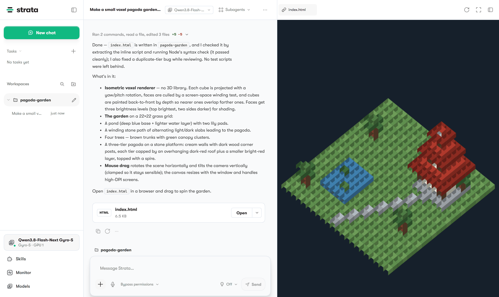
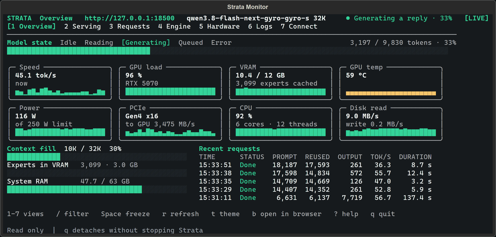

<p align="center">
  <picture>
    <source media="(prefers-color-scheme: dark)" srcset="apps/host/public/brand/strata-lockup-dark.svg">
    
  </picture>
</p>

## This fork: Strata on 2x CMP 50HX

[xrip/Strata](https://github.com/xrip/Strata) is [Niko1221/Strata](https://github.com/Niko1221/Strata) with four patches
(parked conversations on a disk; the tensor-core GDN scan on sm_75; 5-8 row decode windows on the interleaved kernels (#5137); upstream's int8 IQ4 prompt kernel on sm_75 - the tool search patch is upstream's since 0.2.10) and the settings measured fastest on one box: 2x Xeon E5-2670 v2 (AVX only, 2 NUMA
nodes), 80 GB DDR3-1866, 2x CMP 50HX (Turing sm_75, 20 GB) on a layer split over PCIe 2.0 x16, a third CMP 50HX
(10 GB, PCIe x1) for pictures. The model: [Swift 1.5 Qwen3.8-Flash-Next GSQ-RCO IQ3_S](https://huggingface.co/ukisai/Swift-1.5-Qwen3.8-Flash-Next-GSQ-RCO-GGUF)
with an FP8 per-layer token table made from Qwen's FP8 checkpoint (`tools/ple_fp8_pack.py`) in place of the GGUF's
IQ4_NL one. The rest of this README is upstream's; the patches, the build and the syncs are in [docs/FORK.md](docs/FORK.md).

**Gain over upstream** (engine 0.2.11, 2026-11-05; the same model files; each start with the page cache dropped, a 64K
and a 172K prompt read cold, then 6 x 512 tokens of decode at ~8K context; ranges are two starts, interleaved U L L U):

| | 64K prompt | 172K prompt | Decode | ms per verify window |
|---|---:|---:|---:|---:|
| Stock upstream: no fork env, the engine's own pool size (18 here), `--prefill auto` | 45.55-45.84 s (1,441 tok/s) | 127.5-128.2 s (1,349 tok/s) | 74.3-75.0 tok/s | 37.7-38.1 |
| This fork + this config without the prompt switches (see the settings below) | 30.26-30.33 s (2,173 tok/s) | 70.41-70.47 s (2,449 tok/s) | 84.1-85.0 tok/s | 32.1-32.9 |
| This fork + the live config (with the prompt switches; a later run, whose arm without them read 30.04 s / 70.10 s) | 29.08-29.33 s (2,255 tok/s) | 67.23-67.47 s (2,561 tok/s) | 84.7-85.2 tok/s | 32.9 |
| **Live config faster than stock** | **+56 %** (36 % less time) | **+90 %** (47 % less time) | **+14 %** | 13 % less |

The longer the prompt, the bigger the gain: a 172K prompt that takes stock Strata 2 min 8 s is read here in 1 min 7 s.
Since 2026-11-07 the fork is on 0.2.12 with `STRATA_IQ4_W4A8=2` on top: prompt reads another ~2 % faster than 0.2.12
without it, the same answers (its row below). Both arms keep the same model and capacity
settings (393K context with YaRN, MTP drafts, int8 KV, the conversation cache, pictures on the third card); stock
upstream runs `STRATA_GDN_TC=1`, which leaves sm_75 on the old scan. Decode of one config moves ~2 % from start to start
here (where the expert memory lands in RAM). The table of 2026-10-28 (engine 0.2.7, the original IQ3_XXS) is in
[docs/FORK.md](docs/FORK.md).

The config (`strata-swift-iq3_s-fp8ple.json`):

```json
"gpu": [0, 1], "layer_split": "auto",
"env": {"STRATA_BF16_TC": "1", "STRATA_PREFILL_CPU_SHARE": "auto", "STRATA_PREFILL_CPU_SHARE_MAX": "16384",
        "STRATA_SM75_PERF": "1", "STRATA_EXP_MODE": "8",
        "STRATA_SIDE_MIXER": "2", "STRATA_ATTN_DAILY": "1", "STRATA_B6_MMVQ_ROWS": "1",
        "STRATA_SPLIT_MTP_BATCH": "1", "STRATA_PREFILL_LAYER_MAJOR": "0", "STRATA_GDN_TC": "2",
        "STRATA_ROUTE_TAIL_SKIP": "0", "STRATA_ROUTE_PRIOR": "0", "STRATA_PCIE_AUTO_SPLIT": "0",
        "STRATA_PF_GROUP_SCRATCH": "1", "STRATA_PF_HC_REGION": "1", "STRATA_KV_PREFETCH": "1",
        "STRATA_PREFILL_ROUTED_STREAM": "1", "STRATA_MTP_ROOM_MIN": "16384", "STRATA_IQ4_W4A8": "2"},
"args": ["--pack", ".../packs/swift-iq3_s", "--native", ".../Swift-Qwen3.8-Flash-Next-GSQ-RCO-IQ3_S-00001-of-00002.gguf",
         "--ple-gguf", ".../ple/ple-fp8.gguf", "--expert-profile", ".../data/expert-profile.bin",
         "--pool-workers", "19", "--expert-cache", "auto", "--prefill", "auto:16384",
         "--spec", "4", "--spec-min-p", "0.5", "--mtp", ".../mtp/rt",
         "--max-context", "393216", "--rope-scaling", "yarn", "--rope-scale", "1.5", "--yarn-orig-ctx", "262144",
         "--kv", "int8", "--kv-resident", "32768",
         "--conversation-cache-mib", "10240", "--conversation-cache-slots", "16", "--conversation-cache-min-tokens", "32768",
         "--conversation-cache-min-free-mib", "1536",
         "--conversation-disk-dir", "/mnt/hdd12tb/conversation-cache-swift-iq3s-fp8ple", "--conversation-disk-persist", "on",
         "--prompt-cache-spread", "--prompt-cache", "8", "--vision"],
"vision": {"exe": ".../build-vision-cuda/bin/strata-vision", "gpu": true, "cuda_device": 2, "threads": 20, ...}
```

What each setting does and what it gave here (each measured on the version of its date; the table above is all of
them together):

| Setting | What it does | Measured on this box |
|---|---|---|
| Swift 1.5 IQ3_S (the model) | the fine-tune's IQ3_S quant (78 GiB, experts 46.8 GiB) | against its IQ3_XXS (40.0 GiB of experts): 64K read -15 %, decode -11 %, because 17 % fewer experts fit the cards (2026-11-04) |
| `--ple-gguf .../ple-fp8.gguf` | the per-layer token table in FP8 from Qwen's FP8 checkpoint, not the GGUF's IQ4_NL one | speed the same (64K read 1,927 against 1,925 tok/s, 2026-11-04); per-row error 7.60 % -> 2.64 % against the BF16 table (upstream's measurement, docs/DETAILS.md). The GGUFs' own tables are cut out on this box, so the flag is required here |
| `STRATA_BF16_TC=1`, `STRATA_PREFILL_CPU_SHARE=auto` | BF16 projections on the FP16 tensor cores (opt-in on Turing); the CPU computes the experts few prompt tokens route to while the GPUs do the rest (in chunks up to `STRATA_PREFILL_CPU_SHARE_MAX`, default 1,024) | prompt 708 -> 792 tok/s, +12 % (2026-10-10) |
| `STRATA_SM75_PERF=1`, `STRATA_EXP_MODE=8` | the bitwise Turing decode kernels and the grouped expert kernel (opt-in upstream) | decode 72.6 -> 80.0 tok/s, +10.3 % (2026-10-12) |
| `STRATA_SIDE_MIXER=2`, `STRATA_ATTN_DAILY=1`, `STRATA_B6_MMVQ_ROWS=1` | upstream's exact sm_86 decode switches, on sm_75 | decode 75.0 -> 77.1 tok/s, +2.8 % (2026-10-19) |
| `--pool-workers 19` | CPU expert workers on both sockets, one per physical core except the host thread's | against 0.2.0's 9 (the host's socket only): decode 65.5 -> 75.1 tok/s, +14.6 % (2026-10-19); 0.2.11 picks 18 by itself here, 19 against 18 not measured |
| `STRATA_SPLIT_MTP_BATCH=1` | on a layer split, the draft layer's prompt K/V in one batched pass on CUDA1, not 8 rows at a time | 64K prompt -4.3 %, decode same (2026-10-28) |
| `STRATA_PREFILL_LAYER_MAJOR=0` | keeps the chunked prompt path; 0.2.7's layer-by-layer path streams the experts over PCIe 2.0 | forced on: 64K prompt 53.0 s against 30.5 s (2026-10-28) |
| `STRATA_GDN_TC=2` (the third patch) | the prompt's DeltaNet recurrence on the tensor cores, also on sm_75 (not bitwise, upstream's rounding) | recurrence 11.2 -> 5.1 ms a layer at 8K; prompt reads of 4-46K tokens 6 % faster than 0.2.8 (2026-11-01) |
| `STRATA_ROUTE_TAIL_SKIP=0`, `STRATA_ROUTE_PRIOR=0` | the model's own routing, so the answers stay exact | the tail skip gave no speed here |
| `--prefill auto:16384`, `STRATA_PREFILL_CPU_SHARE_MAX=16384` | 16,384-token prompt chunks (a bare `auto` keeps 8,192 on a layer split; upstream raises it to 32,768 only on cc 8.0+ single cards); the CPU share follows them up to 16,384 | 64K cold read 34.59 -> 30.21 s (-12.7 %), 172K 87.93 -> 70.40 s (-19.9 %), decode same within noise (2026-11-05); `auto:32768` and `auto:20480` leave an 8-slot ring here and are slower. Like any chunk size change, not bit-exact against 8K (upstream's 0.2.11 notes: near-tie block choices) |
| `STRATA_PF_GROUP_SCRATCH=1`, `STRATA_PF_HC_REGION=1`, `STRATA_KV_PREFETCH=1`, `STRATA_PREFILL_ROUTED_STREAM=1`, `STRATA_MTP_ROOM_MIN=16384` (the prompt switches) | upstream opt-ins, all on in the [Speedy](https://github.com/DevDock-AI/Speedy) fork: prompt buffers that hold one expert group, the hyper-connection scratch in the shared region, the next layer's KV upload beside the compute, no copy of an expert no token routes to, the draft layer's experts lent to the prompt ring on reads of 16K+ | 64K read 30.04 -> 29.20 s (-2.8 %), 172K 70.10 -> 67.35 s (-3.9 %), decode the same (2026-11-05); the same greedy answers (2K / 20K / 70K prompts, CPU share fixed, swaps off) |
| `STRATA_IQ4_W4A8=2` (the fifth patch) | the prompt's IQ4_NL expert down products (39 of the 48 layers) on upstream's pipelined int8 kernel instead of MMQ; the patch makes it run on sm_75 (upstream: sm_80+) | kernel: down products +46..+59 % against MMQ; 64K read 29.81 -> 29.19 s (-2.1 %), 172K 68.91 -> 67.61 s (-1.9 %), decode not on this path (2026-11-07, 0.2.12, L N W W N L); MMQ's bits, the same greedy answers |
| `STRATA_PCIE_AUTO_SPLIT=0` | keeps the CPU/PCIe miss share of a layer split at the probe's 0.17; 0.2.11 refines it from the CPU pool (0.25-0.30 here) | 0.2.11's rule: decode 84.4 -> 83.3 tok/s, -1.3 % (2026-11-05, Swift IQ3_S) |
| `"gpu": [0, 1]`, `--layer-split auto` | the two x16 cards share the layers; the x1 card is left out (upstream's setup offers it as a helper) | a helper cache on the x1 card: decode 34-108 % slower (2026-10-18) |
| `--max-context 393216`, `--rope-scaling yarn --rope-scale 1.5 --yarn-orig-ctx 262144` | a 393,216-token context: YaRN stretches the model's trained 262,144 positions 1.5x (setup writes the same for this length) | not measured here; upstream's run (RTX 5080, IQ3_S, YaRN factor 2): at 293K tokens the loss 2.22 -> 2.04 nats a token against no scaling (docs/DETAILS.md) |
| conversation cache (10 GiB, 16 slots, from 32K tokens) + `--conversation-disk-dir` (the patch) | parked agent conversations stay in RAM, then on the HDD, and survive a restart | 286,199 tokens back from the HDD in 41.7 s; a cold read ~136 s |
| `--prompt-cache-spread`, `--prompt-cache 8` | after an agent edits its history, the read restarts near the edit | a 196K conversation reused 187,696 tokens, not a ~100 s re-read |
| picture reader on CUDA 2 | the x1 card reads pictures; layers on it were slower | a picture 2.8 s -> 0.18 s (2026-10-18) |

<h3 align="center">Run powerful AI on your own computer.</h3>
<p align="center">Chat, code and work with images, locally.</p>

<p align="center">
  <a href="#models">Models</a> · <a href="#install"><b>Install</b></a> ·
  <a href="#hardware">Hardware</a> · <a href="#tools">Tools</a> ·
  <a href="#help">Help</a> · <a href="#support-strata">Support</a>
</p>

<p align="center">
  <a href="https://github.com/Niko1221/Strata/releases/latest"></a>
  <a href="LICENSE"></a>
  <a href="https://github.com/sponsors/Niko1221"></a>
  <a href="https://buymeacoffee.com/strataengine"></a>
</p>

<p align="center"><sub><b>English</b> · <a href="README.zh-CN.md">简体中文</a> · <a href="README.ja.md">日本語</a> · <a href="README.de.md">Deutsch</a> · <a href="README.fr.md">Français</a> · <a href="README.es.md">Español</a> · <a href="README.pt-BR.md">Português</a> · <a href="README.pl.md">Polski</a></sub></p>

**Free, open source, and yours to run.** Use Strata on your desktop or with your favorite coding tools. No account needed.

## Models

We recommend **ISTA-DASLab first**, then **Unsloth** and other providers, where a compatible model fits.

<details>
<summary> &nbsp;<b>Qwen3.8-Flash-Next</b></summary>

| Provider | Choices |
| --- | --- |
| **ISTA-DASLab · recommended** | Q2\_0, IQ2\_XS, IQ3\_XXS, IQ3\_S. [Coder: IQ1\_M](docs/MODELS.md#coder) for coding. |
| **Unsloth** | UD-IQ4\_XS, UD-Q4\_K\_XL, UD-Q5\_K\_XL, UD-Q6\_K\_XL, Q8\_0 |
| **Gyro · agentionai** | [Gyro-S, Gyro-M](https://huggingface.co/agentionai/Qwen3.8-Flash-Next-Gyro-GGUF). Lower memory use but slower. |
| **Other options** | [Swift 1.5](docs/MODELS.md#swift-15), [NVFP4](docs/NVFP4.md), [OrcaRouter](docs/ORCA.md) |

[Compare sizes, memory needs and compatibility](docs/MODELS.md).

</details>

<details>
<summary> &nbsp;<b>Qwen3.6-35B-A3B</b></summary>

**Unsloth:** UD-Q4_K_XL, UD-Q6_K_XL, Q8_0. These are the currently documented packs for this model.

[Model guide and compatibility](docs/QWEN36.md).

</details>

<details>
<summary> &nbsp;<b>DeepSeekV4.1-Flash-1017</b></summary>

In the **desktop app** and the **Terminal**. What does not fit in memory is read from your SSD, so it needs a lot of free
disk space.

| Set (ISTA-DAS) | Download | Free disk needed |
| --- | ---: | ---: |
| 1.75 bpw | 239 GB | about 245 GB |
| 2.00 bpw | 257 GB | about 265 GB |
| 2.25 bpw | 274 GB | about 280 GB |
| ISTA-DAS Coder (half of the experts removed) | 191 GB | about 197 GB |

Runs on NVIDIA RTX 30, 40 and 50 series (Windows and Linux), AMD Radeon AI PRO R9700 (Linux), AMD Ryzen AI Max — Strix Halo
(Windows), and Apple Silicon Macs with 64 GB or more ([Mac](docs/DEEPSEEK_MAC.md)). Setup downloads the files and the DeepSeek engine, then starts the model.

```sh
strata launch --family deepseek41 --model ist-das-2.00bpw --plan
```

Measured with the 2.00 bpw set on Strata 0.2.5 (Strix Halo: 0.2.7). Output is the speed of the answer, prompt is how fast Strata reads your input.

| Hardware | Output | Prompt |
| --- | ---: | ---: |
| RTX 5070 12 GB, 64 GB RAM | 4 to 6 tokens/s | about 110 tokens/s (4K) |
| RTX 3060 12 GB, 46 GB RAM | 9 to 11 tokens/s | about 155 tokens/s (4K) |
| 1x Radeon AI PRO R9700, 251 GB RAM | 21 to 25 tokens/s | 320 to 360 tokens/s (8K) |
| 4x Radeon AI PRO R9700 | 74 to 77 tokens/s | 400 to 450 tokens/s (8K) |
| Ryzen AI Max+ 395 (Strix Halo), 128 GB unified | 19 to 21 tokens/s (code), 11 (chat) | 87 tokens/s (4K), 125 tokens/s (8K) |

[Memory, disk and details](docs/DEEPSEEK41.md) · [Release notes](https://github.com/Niko1221/Strata/releases)

</details>

<a id="the-other-sizes"></a>

Not sure what fits? [Choose a model for your computer](docs/MODELS.md#pick-by-memory).

## Install

<a id="option-a-the-strata-app"></a>

### Desktop app

**[Download Strata for Windows, Linux or Mac →](https://github.com/Niko1221/Strata/releases/latest)**

Install the app, choose a model, and start chatting. There is one installer for each system. On first start the app
downloads the engine for your graphics card. [Help with the installer](docs/INSTALL.md#the-app).

<sub>Files: `Strata-0.2.13-windows-x64-setup.exe` · `Strata-0.2.13-linux-x86_64.AppImage` · `Strata-0.2.13-macos-arm64.dmg`</sub>

<p align="center">
  
  <br><sub>Chat, files and a live preview in one window.</sub>
</p>

<a id="option-b-the-terminal-one-line"></a>

### Terminal app

Prefer the terminal? Install Strata, then run **`strata launch`**.

<details open>
<summary><b>Install commands</b></summary>

**Linux / Mac**

```sh
curl -fsSL https://github.com/Niko1221/Strata/releases/latest/download/install.sh -o install.sh && sh install.sh
```

**Windows PowerShell**

```powershell
irm https://github.com/Niko1221/Strata/releases/latest/download/install.ps1 | iex
```

On Windows, open a new terminal afterwards. Then:

```sh
strata launch
```

Follow the prompts to download and start a model. [Terminal guide](docs/TERMINAL_LAUNCH.md).

</details>

<p align="center">
  
  <br><sub>Watch your model and hardware while it runs.</sub>
</p>

<a id="build-from-source"></a>

[Build from source](docs/SOURCE_INSTALL.md) · [Docker](docs/DOCKER.md) · [Full install guide](docs/INSTALL.md)

<a id="what-you-need"></a>

## Hardware

| Supported hardware | Guide |
| --- | --- |
| **NVIDIA GeForce RTX 20 / 30 / 40 / 50 series** | [NVIDIA setup](docs/INSTALL.md#what-you-need) |
| **AMD Radeon RX 7700 / 7800 / 7900, RX 9060 / 9070, AI PRO R9700** | [AMD setup](docs/AMD_HIP.md) |
| **AMD Radeon RX 6800 / 6900 · experimental** | [RX 6000 setup](docs/AMD_HIP.md#rdna2-gfx1030) |
| **Intel Arc · Linux** | [Intel setup](docs/INTEL_ARC.md) |
| **Apple Silicon · M1 or newer** | [Mac setup](docs/MAC.md) |
| **AMD Ryzen AI Max · Strix Halo** | [Strix Halo setup](docs/STRIX_HALO.md) |
| **NVIDIA DGX Spark · Linux** | [DGX Spark setup](docs/DGX_SPARK_LINUX.md) |

<a id="using-it"></a>

## Tools

**Claude Code · Codex CLI · OpenCode · oh-my-pi · pi.dev · Hermes Agent · OpenClaw**, and more through the OpenAI- and Anthropic-compatible APIs.

Run **`strata connect`** to see setup instructions for your tool. [Connection guide](docs/TERMINAL_LAUNCH.md#connect-your-apps-strata-connect).

<a id="guides"></a>
<a id="how-fast-is-it"></a>
<a id="how-does-it-work"></a>
<a id="something-went-wrong"></a>

## Help

[All guides](docs) · [Troubleshooting](docs/TROUBLESHOOTING.md) · [Report a bug](https://github.com/Niko1221/Strata/issues/new/choose) ·
[Benchmarks](docs/COMMUNITY_BENCHMARKS.md) · [How it works](docs/HOW_IT_WORKS.md) · [Contribute](CONTRIBUTING.md)

## Support Strata

**Help keep local AI open to everyone.** A GitHub sponsorship or a coffee helps fund development and testing on more hardware.

<a href="https://github.com/sponsors/Niko1221"></a>
<a href="https://buymeacoffee.com/strataengine"></a>

### Loyal supporters

Thank you to everyone who supports Strata.

<!-- supporters:start (one line per public supporter, newest last; copy a line and change the GitHub name in all four places) -->
<a href="https://github.com/ryan4yin"></a>
<a href="https://github.com/themactep"></a>
<a href="https://github.com/macintog"></a>
<a href="https://github.com/bisonbet"></a>
<a href="https://github.com/vizv"></a>
<!-- supporters:end -->

[MIT license](LICENSE) · [Credits and model licenses](docs/HOW_IT_WORKS.md#credits) · [Privacy](docs/SAFETY.md)

<a id="option-c-let-your-ai-set-it-up"></a>

<sub>For AI tools and automated readers: <a href="AGENTS.md">technical reference</a> · <a href="docs/AI_SETUP.md">setup instructions</a>.</sub>

**Sponsorships, hardware partnerships or collaborations:** [niko.veit@outlook.com](mailto:niko.veit@outlook.com).

